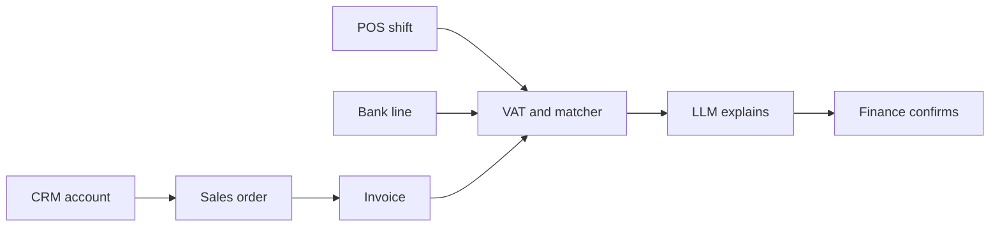

# Architecture — Quầy Tillbridge

Finance and sales share one commercial schema: CRM, orders, invoices, stock, POS, bank lines. Rules compute tax and matches; the model explains; a person confirms.

## Boundaries

| Layer | Responsibility |
| --- | --- |
| `src/server/vat.ts` | Invoice subtotal, VAT, total |
| `src/server/match-bank.ts` | Bank line ↔ invoice/shift candidates |
| `src/server/redact.ts` | Model-facing JSON |
| `src/server/policy.ts` | Role capabilities |
| `src/server/shift-close.ts` | Shift break + idempotency key |
| `src/lib/ai/client.ts` | Narration / explanation / shift note (demo or live) |

## Automation

Flow `close_shift`: sum tickets → compare declared → exception if \|break\| > 20 000 VND → model note from redacted facts → `automation_run`. Idempotency key `close_shift:{shift_id}`. Optional `AUTOMATION_WEBHOOK_URL` for n8n/Make.

## Data store

Single Neon Postgres per app. Prisma schema mirrors the SQL in `SPEC.md`.
