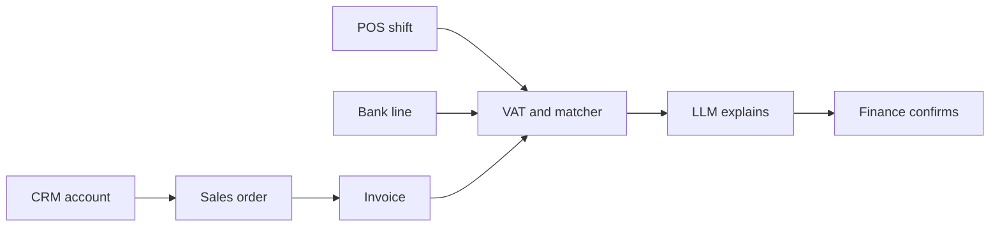

# SPEC — Quầy Tillbridge

Portfolio demonstration for the Sharon JSC AI Implementation Specialist role. Not an official Sharon system.

Product name on screen: **Quầy**. Kicker: `TILLBRIDGE · PORTFOLIO`.

## Product vision

A finance controller and a salesperson share one commercial system for a demo bakery: accounts, orders, invoices, stock moves, POS shifts, and bank lines. The interesting part is the boundary. VAT is a function. A bank match is a rule. The model writes Vietnamese and English prose from a payload that already had tax ids, phones, and account numbers removed. Finance confirms. Sales cannot see the bank queue.

This app owns **finance** and **sales**, including CRM, ERP-style documents, and POS. It does not run the ovens.

## Personas

| Persona | Role cookie | Need |
| --- | --- | --- |
| Khoa Võ, sales | `sales` | Log a visit, raise a gift-box order, see a masked tax code, stay out of the bank. |
| Hà Lê, finance | `finance` | Issue an invoice, resolve an ambiguous transfer, close a shift, read the audit. |
| Ánh Đặng, director | `leadership` | Read totals and plain-language exceptions. Cannot confirm a match or void an invoice. |

| Action | sales | finance | leadership |
| --- | --- | --- | --- |
| Read CRM and orders | yes | yes | yes |
| Create order | yes | yes | no |
| See full tax code and phone | no | yes | no |
| Draft and issue invoice | no | yes | no |
| Void invoice | no | yes | no |
| See bank lines and reconciliation | no | yes | masked totals only |
| Confirm or reject a match | no | yes | no |
| Run shift-close automation | no | yes | no |
| Read audit | no | yes | yes, without raw payload bodies |

Leadership bank view: count of open cases and total VND, no description and no last-4. The API used by the leadership UI is `/api/reconcile/summary`.

## User stories

1. As Khoa, I open Atelier Demo Co. and read the 30 Oct visit note about year-end boxes.
2. As Khoa, I see tax code and phone masked, so a sales login is not a full export of the account.
3. As Hà, I draft invoice lines from order `so-200` and the VAT đồng matches the code, not a sentence from the model.
4. As Hà, I see two open invoices at 1,250,000₫ and a bank line with no reference, and the confirm button stays disabled until I choose which invoice.
5. As Hà, I see HĐ-1100 proposed as a single high-confidence match because the description contains the number.
6. As Khoa, I receive 403 on the bank API.
7. As Hà, I close the Nguyễn Huệ shift and get the same run log if I click twice.
8. As Ánh, I read a plain-language note about the 45,000₫ shift break without seeing a bank account.
9. As Hà, I open the security page and compare the raw account fields with the JSON that would be sent to the model.
10. As Minh (visiting), I can read the sales and finance process maps and the requirement ids `QT-R01` through `QT-R08`. Minh has no login here; the process page is readable by every role.

## Commercial facts the seed must include

Today: **2026-11-02**. Currency: VND integers. VAT basis points on every item: **800**.

```
vat = Math.round(subtotal * vat_rate_bps / 10000)
total = subtotal + vat
```

Worked invoice `so-200`: SKU `GQ-TET`, qty **4**, unit **350000**, subtotal **1400000**, VAT **112000**, total **1512000**. No invoice exists yet at seed time. Customer `cus-atelier` (Atelier Demo Co.), segment `corporate`, tax code `0312345678`, phone `0901234567`, owner `khoa`. CRM activity `act-atelier-1` on **2026-10-30**: `Year-end gift boxes, deliver before 15 Dec`.

Ambiguous case:

| Record | Value |
| --- | --- |
| `inv-1042` | number `HĐ-1042`, customer Atelier, total **1250000**, issued 2026-11-01, status `issued` |
| `inv-1048` | number `HĐ-1048`, customer `cus-cafe-td` (Café Demo Thảo Điền), total **1250000**, issued 2026-11-01, status `issued` |
| `bl-77` | posted 2026-11-02, amount **1250000**, description `CHUYEN KHOAN 1250000`, last4 `4412` |

The matcher must return status `ambiguous` and must not pick a winner.

Clean case:

| Record | Value |
| --- | --- |
| `inv-1100` | number `HĐ-1100`, total **756000**, issued 2026-11-01, status `issued` |
| `bl-80` | posted 2026-11-02, amount **756000**, description `HD1100 NGUYEN HUE`, last4 `4412` |

The matcher returns one candidate, confidence `0.9`, status `proposed`.

Shift break:

| Field | Value |
| --- | --- |
| `sh-nh-1101` | outlet `CTR-NH`, business date 2026-11-01, status `closed` |
| Tickets | sum **2500000** |
| Declared | cash **1500000**, card **955000** |
| Break | **45000** short |

Threshold for an exception is **20000**. This shift is an exception.

Stock: `GQ-TET` move in **20** on 2026-10-28, and a reservation out **4** linked to `so-200`.

Add at least six more customers, a mix of `cafe`, `retail`, and `corporate`, and enough issued invoices that the list is not only the three above. Do not create a second pair of equal amounts. Do not put `HĐ-1100` or `1042` or `1048` inside `bl-77`.

Outlets and SKUs match the root architecture catalogue, including prices.

## Matching rules

Pure function `matchBankLine(line, invoices, shifts)`.

- Amount tolerance is **1000** VND. Date window is the bank date and the previous day against `issued_on` or `business_date`.
- A candidate is strong when the normalized description contains the invoice number with punctuation removed (`HĐ-1100` and `HD1100` both match).
- Exactly one strong candidate: `proposed`, confidence `0.9`.
- Exactly one amount candidate and no strong reference: `proposed`, confidence `0.6`, `needs_choice: true`. Confirm is still a human action.
- Two or more amount candidates: `ambiguous`, confidence `0.4`, `needs_choice: true`, no default invoice id.
- Zero candidates: `unmatched`.

`POST /api/reconcile/:id/confirm` requires role `finance`, a chosen document id, and status still open. Ambiguous confirm without `chosenInvoiceId` returns **409** `CHOICE_REQUIRED`. Sales and leadership receive **403**.

The model never selects the winner. It receives `{ line: { amount, posted_on, description_redacted }, candidates: [{ invoice_number, amount, customer_name }] }` with last4, tax codes, and phones removed. Description redaction strips digit runs of length 8 or more.

## Shift-close automation

Flow key `close_shift`. Steps, in order, shown on `/automations`:

1. Sum tickets (code).
2. Compare to declared cash plus card (code).
3. If the absolute break exceeds 20000, mark `exception`.
4. Ask the model, or the fixture, for a plain-language note from `{ outlet_id, business_date, ticket_total, declared_total, break_vnd }` only.
5. Write `automation_run`.

Idempotency key `close_shift:sh-nh-1101`. A second run returns the first row and does not insert another.

If `AUTOMATION_WEBHOOK_URL` is set, POST the run id, flow key, and break amount after the row is stored. If it is empty, skip. The demo must work with it empty. Document this as the n8n / Make handoff: the same JSON can be the webhook body those tools receive. Do not require a live n8n instance.

## Process map

Route `/process`.

Sales stream:

1. Qualify the account — sales — CRM.
2. Log the visit note — sales — CRM — pain: the promise sits in a personal chat.
3. Draft the order — sales — ERP — this status is the quote; there is no second quote table, and the page says so.
4. Confirm the order — sales — ERP.

Finance stream:

1. Draft the invoice — finance — ERP.
2. Issue the invoice — finance — ERP — pain: tax was retyped by hand.
3. Import the bank line — finance — bank file.
4. Match or leave ambiguous — finance — Tillbridge.
5. Confirm the match — finance — Tillbridge.

POS stream:

1. Open the shift — counter lead — POS.
2. Ring tickets — counter — POS.
3. Close and compare declared takings — finance — Tillbridge — pain: a short till is discovered the next afternoon.

Seed `QT-R01`–`QT-R08` with the statements from the root architecture crosswalk. Attach them to the closest step: R01 issue invoice, R02 confirm order, R03 match, R04 match, R05 qualify account, R06 close shift, R07 issue invoice, R08 draft invoice.

## Screens

| Route | Purpose |
| --- | --- |
| `/` | Headline `Sổ quầy chưa khớp` / `What the till still owes`. Three figures: open invoice total, ambiguous or proposed count, oldest shift break. |
| `/crm` | Accounts. Masked fields follow the role. |
| `/crm/[id]` | Activities and orders. |
| `/orders/[id]` | Lines and the draft-invoice action. |
| `/invoices` | List, issue, void. |
| `/pos` | Shifts and tickets. |
| `/reconcile` | Finance queue. Leadership summary. Sales: a 403 panel with a sentence about why. |
| `/automations` | The close-shift flow and its run log. |
| `/security` | Raw versus redacted payload for Atelier, role matrix, last audit rows the role may see. |
| `/process` | Three streams and requirement cards. |
| `/trust` | Where the model is weak: same amounts, OCR-like descriptions, VAT, demo mode. |

Desktop first, still usable at 768px. Wordmark **Quầy**. Same color tokens as the architecture doc. Integers formatted with `vi-VN`.

Invoice narration from the model may mention the visit note and the delivery date. It must not state a total that differs from `1512000` or a VAT that differs from `112000`. The screen shows the computed figures in a separate column labeled as calculated.

## Tech stack

Same platform as the root architecture: Next.js App Router, TypeScript, Tailwind, Prisma, Neon, Vercel AI SDK, Zod, `tsx --test`. No Python service. No payment gateway. No shadcn theme as the visual base.

## Folder structure

```
projects/quay-tillbridge/
  SPEC.md
  README.md
  SECURITY.md
  ARCHITECTURE.md
  DEMO_URL.txt
  .env.example
  .gitignore
  package.json
  prisma/schema.prisma
  prisma/migrations/
  prisma/seed.ts
  src/app/... pages listed above
  src/app/api/health/route.ts
  src/app/api/session/role/route.ts
  src/app/api/crm/accounts/route.ts
  src/app/api/crm/accounts/[id]/route.ts
  src/app/api/orders/route.ts
  src/app/api/orders/[id]/invoice/route.ts
  src/app/api/invoices/[id]/issue/route.ts
  src/app/api/invoices/[id]/void/route.ts
  src/app/api/reconcile/queue/route.ts
  src/app/api/reconcile/summary/route.ts
  src/app/api/reconcile/[id]/confirm/route.ts
  src/app/api/reconcile/[id]/reject/route.ts
  src/app/api/shifts/[id]/close/route.ts
  src/app/api/automations/route.ts
  src/app/api/audit/route.ts
  src/components/SiteHeader.tsx
  src/components/DisclaimerFooter.tsx
  src/components/AiModeBanner.tsx
  src/components/TrustPanel.tsx
  src/components/RoleGate.tsx
  src/i18n/en.ts
  src/i18n/vi.ts
  src/lib/db.ts
  src/lib/format.ts
  src/lib/session.ts
  src/lib/ai/client.ts
  src/lib/ai/demo-fixtures.ts
  src/server/vat.ts
  src/server/match-bank.ts
  src/server/redact.ts
  src/server/policy.ts
  src/server/shift-close.ts
  tests/vat.test.ts
  tests/match-bank.test.ts
  tests/redact.test.ts
  tests/policy.test.ts
```

## SQL schema

```sql
CREATE TABLE app_user (
  id TEXT PRIMARY KEY,
  name TEXT NOT NULL,
  role TEXT NOT NULL CHECK (role IN ('sales', 'finance', 'leadership'))
);

CREATE TABLE customer (
  id TEXT PRIMARY KEY,
  name TEXT NOT NULL,
  segment TEXT NOT NULL CHECK (segment IN ('cafe', 'retail', 'corporate', 'internal')),
  tax_code TEXT,
  phone TEXT,
  district TEXT,
  owner_user_id TEXT NOT NULL REFERENCES app_user(id)
);

CREATE TABLE crm_activity (
  id TEXT PRIMARY KEY,
  customer_id TEXT NOT NULL REFERENCES customer(id),
  kind TEXT NOT NULL CHECK (kind IN ('visit', 'call', 'note')),
  body TEXT NOT NULL,
  at TIMESTAMPTZ NOT NULL
);

CREATE TABLE item (
  sku TEXT PRIMARY KEY,
  name_en TEXT NOT NULL,
  name_vi TEXT NOT NULL,
  unit_price_vnd INT NOT NULL CHECK (unit_price_vnd >= 0),
  vat_rate_bps INT NOT NULL CHECK (vat_rate_bps >= 0)
);

CREATE TABLE sales_order (
  id TEXT PRIMARY KEY,
  customer_id TEXT NOT NULL REFERENCES customer(id),
  status TEXT NOT NULL CHECK (status IN ('draft', 'confirmed', 'cancelled')),
  ordered_on DATE NOT NULL,
  note TEXT
);

CREATE TABLE sales_order_line (
  id TEXT PRIMARY KEY,
  order_id TEXT NOT NULL REFERENCES sales_order(id),
  sku TEXT NOT NULL REFERENCES item(sku),
  qty INT NOT NULL CHECK (qty > 0),
  unit_price_vnd INT NOT NULL
);

CREATE TABLE invoice (
  id TEXT PRIMARY KEY,
  order_id TEXT REFERENCES sales_order(id),
  number TEXT NOT NULL UNIQUE,
  status TEXT NOT NULL CHECK (status IN ('draft', 'issued', 'paid', 'void')),
  issued_on DATE,
  subtotal_vnd INT NOT NULL,
  vat_vnd INT NOT NULL,
  total_vnd INT NOT NULL,
  narration_en TEXT,
  narration_vi TEXT,
  narration_mode TEXT CHECK (narration_mode IN ('demo', 'live', 'fallback')),
  created_at TIMESTAMPTZ NOT NULL DEFAULT now()
);

CREATE TABLE invoice_line (
  id TEXT PRIMARY KEY,
  invoice_id TEXT NOT NULL REFERENCES invoice(id),
  sku TEXT NOT NULL REFERENCES item(sku),
  qty INT NOT NULL,
  unit_price_vnd INT NOT NULL,
  line_subtotal_vnd INT NOT NULL
);

CREATE TABLE stock_move (
  id TEXT PRIMARY KEY,
  sku TEXT NOT NULL REFERENCES item(sku),
  qty INT NOT NULL CHECK (qty > 0),
  direction TEXT NOT NULL CHECK (direction IN ('in', 'out')),
  reason TEXT NOT NULL,
  order_id TEXT REFERENCES sales_order(id),
  at TIMESTAMPTZ NOT NULL
);

CREATE TABLE pos_shift (
  id TEXT PRIMARY KEY,
  outlet_id TEXT NOT NULL,
  business_date DATE NOT NULL,
  status TEXT NOT NULL CHECK (status IN ('open', 'closed')),
  cash_vnd INT NOT NULL DEFAULT 0,
  card_vnd INT NOT NULL DEFAULT 0,
  ticket_total_vnd INT NOT NULL DEFAULT 0,
  break_vnd INT NOT NULL DEFAULT 0
);

CREATE TABLE pos_ticket (
  id TEXT PRIMARY KEY,
  shift_id TEXT NOT NULL REFERENCES pos_shift(id),
  ticket_no TEXT NOT NULL,
  total_vnd INT NOT NULL CHECK (total_vnd >= 0),
  paid_via TEXT NOT NULL CHECK (paid_via IN ('cash', 'card', 'transfer'))
);

CREATE TABLE bank_line (
  id TEXT PRIMARY KEY,
  posted_on DATE NOT NULL,
  amount_vnd INT NOT NULL,
  description TEXT NOT NULL,
  account_last4 TEXT NOT NULL
);

CREATE TABLE rec_case (
  id TEXT PRIMARY KEY,
  bank_line_id TEXT NOT NULL REFERENCES bank_line(id),
  status TEXT NOT NULL CHECK (status IN ('proposed', 'ambiguous', 'unmatched', 'confirmed', 'rejected')),
  invoice_id TEXT REFERENCES invoice(id),
  shift_id TEXT REFERENCES pos_shift(id),
  confidence NUMERIC NOT NULL,
  needs_choice BOOLEAN NOT NULL DEFAULT FALSE,
  explanation_en TEXT,
  explanation_vi TEXT,
  mode TEXT CHECK (mode IN ('demo', 'live', 'fallback')),
  UNIQUE (bank_line_id)
);

CREATE TABLE automation_flow (
  key TEXT PRIMARY KEY,
  name_en TEXT NOT NULL,
  name_vi TEXT NOT NULL,
  definition JSONB NOT NULL
);

CREATE TABLE automation_run (
  id TEXT PRIMARY KEY,
  flow_key TEXT NOT NULL REFERENCES automation_flow(key),
  idempotency_key TEXT NOT NULL UNIQUE,
  status TEXT NOT NULL CHECK (status IN ('completed', 'exception')),
  log JSONB NOT NULL,
  redacted_input JSONB NOT NULL,
  created_at TIMESTAMPTZ NOT NULL DEFAULT now()
);

CREATE TABLE process_step (
  id TEXT PRIMARY KEY,
  stream TEXT NOT NULL CHECK (stream IN ('sales', 'finance', 'pos')),
  sort_order INT NOT NULL,
  name_en TEXT NOT NULL,
  name_vi TEXT NOT NULL,
  owner_role TEXT NOT NULL,
  input_en TEXT NOT NULL,
  output_en TEXT NOT NULL,
  system_name TEXT NOT NULL,
  pain_en TEXT NOT NULL,
  pain_vi TEXT NOT NULL
);

CREATE TABLE requirement (
  id TEXT PRIMARY KEY,
  step_id TEXT NOT NULL REFERENCES process_step(id),
  statement_en TEXT NOT NULL,
  statement_vi TEXT NOT NULL,
  priority TEXT NOT NULL CHECK (priority IN ('now', 'next', 'later')),
  acceptance_en TEXT NOT NULL
);

CREATE TABLE audit_event (
  id TEXT PRIMARY KEY,
  at TIMESTAMPTZ NOT NULL DEFAULT now(),
  actor TEXT NOT NULL,
  action TEXT NOT NULL,
  entity TEXT NOT NULL,
  entity_id TEXT NOT NULL,
  detail JSONB NOT NULL
);
```

Store only `account_last4`, never a full account number. Voiding sets status `void` and does not delete lines.

Invoice numbers for new drafts use the next `HĐ-` sequence inside a transaction.

## API

| Method | Path | Behavior |
| --- | --- | --- |
| GET | `/api/health` | `{ ok, db, ai }` |
| POST | `/api/session/role` | Sets `demo_role`, audits `session.role` |
| GET | `/api/crm/accounts` | Sales and leadership receive `tax_code_masked` (last 3) and `phone_masked` (last 3). Finance receives full values. |
| GET | `/api/crm/accounts/:id` | Same masking, plus activities. |
| POST | `/api/orders` | Sales or finance. |
| POST | `/api/orders/:id/invoice` | Finance only. Creates `draft`. Totals from `vat.ts`. Narration from model or fixture. |
| POST | `/api/invoices/:id/issue` | Finance only. Draft → issued. |
| POST | `/api/invoices/:id/void` | Finance only. Status void. Audit. |
| GET | `/api/reconcile/queue` | Finance only, else 403. |
| GET | `/api/reconcile/summary` | Leadership and finance. |
| POST | `/api/reconcile/:id/confirm` | Finance, with `chosenInvoiceId` when `needs_choice`. |
| POST | `/api/reconcile/:id/reject` | Finance. |
| POST | `/api/shifts/:id/close` | Finance. Idempotent. |
| GET | `/api/automations` | All roles see the definition. Run payloads for leadership are stripped of description text. |
| GET | `/api/audit` | Finance full. Leadership without `redacted_input` blobs. Sales 403. |

On first load of the reconcile screen, upsert `rec_case` rows by running the pure matcher so the queue exists after seed without a manual job. Do this in the server component or a single `ensureCases()` function, not in a public unauthenticated seed route.

Explanation schema:

```ts
{
  explanation_en: string
  explanation_vi: string
  cited_invoice_numbers: string[]
}
```

If the explanation names an invoice number that is not in the candidate list, discard it and use the fixture with flag `MODEL_NUMBER_DRIFT`.

Demo narration for `so-200` mentions delivery before 15 Dec and does not invent a discount. Demo explanation for `bl-77` says the amount matches two invoices and a person must choose. Demo shift note says Nguyễn Huệ is short **45000**.

## Redaction

`toModelPayload` removes `tax_code`, `phone`, `account_last4`, and any digit run of 8 or more characters in free text. The security page shows Atelier’s stored tax code and phone beside the payload, which must not contain `0312345678` or `0901234567`.

Tests must use those two strings as forbidden substrings.

## Security checklist

- Server-side policy on every mutating route and on the bank queue.
- Masking is done in the API, not only in CSS.
- Model payloads are the redacted object and are what `automation_run.redacted_input` stores.
- Confirm and void are audited.
- Invoice totals are computed in one function used by the API and the tests.
- No full bank account, no card PAN, no real payment.
- Void keeps the row.
- Idempotency unique key on automation runs.
- Optional webhook receives id, flow key, and break amount only.
- In-process rate limit on narration and explanation routes.
- `SECURITY.md` includes the production gaps from the root architecture, plus this role matrix.

## Acceptance criteria

- Sales GET `/api/reconcile/queue` is 403, and the reconcile page explains that in the active language.
- Finance sees `bl-77` as ambiguous with both invoice numbers and no preselected winner.
- Finance sees `bl-80` / `HĐ-1100` as a single proposed match.
- Confirming the ambiguous case without a choice is 409. Confirming with `inv-1042` sets status `confirmed` and writes an audit row.
- Drafting `so-200` yields VAT 112000 and total 1512000. A test covers `Math.round(111111 * 800 / 10000) === 8889`.
- Closing `sh-nh-1101` twice returns one run, status `exception`, break 45000.
- Redaction test fails if the model payload contains the Atelier tax code or phone.
- Leadership cannot confirm (403).
- Locale toggle works on the home headline.
- No key, `AI_DEMO_MODE=auto`: banners show `Chế độ minh hoạ — chưa gọi mô hình`, and the ambiguous explanation still renders.
- `npm test`, `npm run typecheck`, `npm run lint`, `npm run build` pass.
- Footer disclaimer is on every page. Copy does not claim a live connection to Sharon’s bank or POS.

## Environment

```
DATABASE_URL=
DIRECT_URL=
OPENAI_API_KEY=
OPENAI_BASE_URL=https://api.openai.com/v1
AI_MODEL=gpt-4o-mini
AI_DEMO_MODE=auto
AUTOMATION_WEBHOOK_URL=
```

## Seed plan

- Users `khoa`, `ha`, `anh` with the roles above.
- Catalogue of eight SKUs at the canonical prices and 800 bps.
- Customers, the Atelier activity, `so-200` confirmed, stock moves, the three invoices that already exist (`inv-1042`, `inv-1048`, `inv-1100`), both bank lines, the Nguyễn Huệ shift and enough tickets to sum to 2500000.
- Additional customers and invoices as supporting cast without a second ambiguous amount.
- Flow definition row `close_shift`.
- Process steps and requirements in both languages.
- Do not pre-confirm `rec_case` rows if `ensureCases()` builds them. Either approach is acceptable if the first finance visit shows the two cases correctly.
- No public seed route.

## Demo script (about two minutes)

1. Open the app as Khoa. Show Atelier’s masked tax code and the 30 Oct note.
2. Switch to Hà. Draft the invoice from `so-200`. Point at VAT 112,000 computed beside the narration.
3. Open reconcile. Show HĐ-1100 proposed, then the 1,250,000₫ pair with confirm blocked until a choice.
4. Choose HĐ-1042 and confirm. Open the audit row.
5. Switch to Khoa and show the bank page refused.
6. As Hà, run close shift on Nguyễn Huệ and show the 45,000₫ exception and the run log. Run it again and show one row.
7. Open `/security` and show the redacted payload. Open `/process` and name `QT-R03` and `QT-R05`.

## README, SECURITY, ARCHITECTURE

README sections match Ovenfloor’s list. JD bullets for this README: sales and finance process maps; CRM, ERP documents, POS, and bank lines in one database; APIs; automation run log and webhook slot; security by role and redaction; honest limit that the model does not calculate tax or post cash.

Vietnamese disclaimer, verbatim:

> Đây là bản minh hoạ portfolio cho vị trí AI Implementation Specialist tại Sharon JSC. Không phải hệ thống, sản phẩm hay thương hiệu vận hành chính thức của Sharon. Dữ liệu là dữ liệu giả lập cho một bếp bánh demo tại TP.HCM.

App `ARCHITECTURE.md` diagram:


